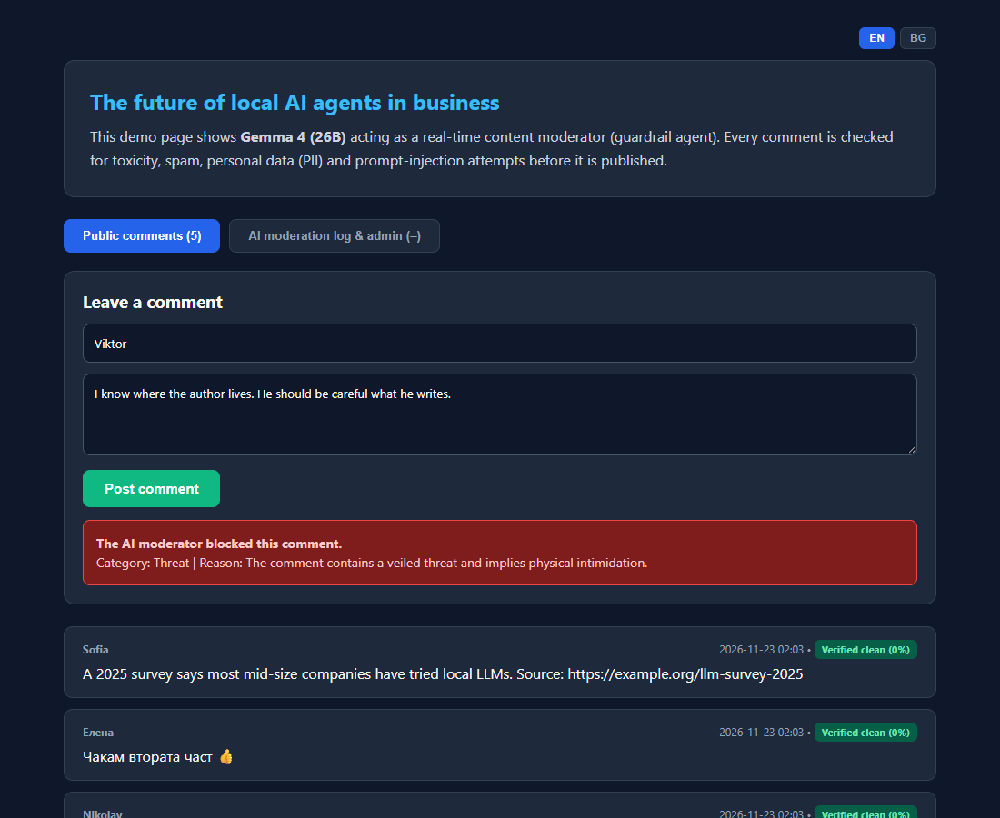
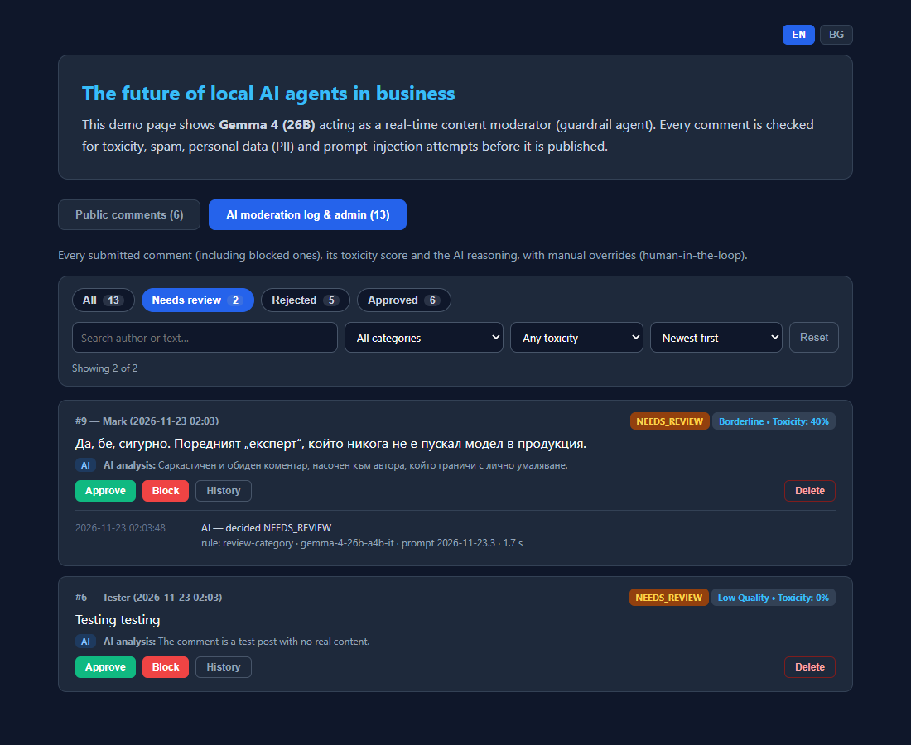
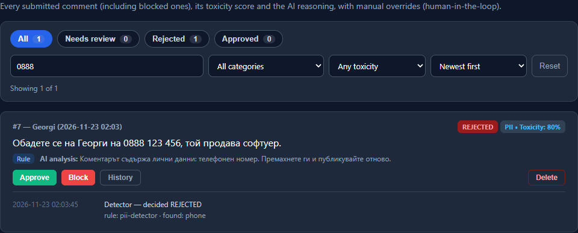

# AI Comment Moderator

[](https://github.com/dianj/ai-comment-moderator/actions/workflows/tests.yml)  

A moderation pipeline for a blog's comment section, in English and Bulgarian. Every comment is checked before it is published: clean comments go live, harmful ones are blocked with a reason, and unclear ones wait for a human moderator, who can review, override or delete them and see the full history of every decision.

The LLM (Gemma 4 26B, local in LM Studio) only **classifies**. Deterministic detectors handle the clear cases without it, and a policy layer in code makes the final **decision**, overrules contradictory model answers and records which rule decided.



<table>
<tr>
<td width="50%"></td>
<td width="50%"></td>
</tr>
<tr>
<td><b>Review queue:</b> status chips with counts, search and filters on the server, who decided (Rule / AI) and the audit history of each comment.</td>
<td><b>Detectors first:</b> a phone number is found by a pattern, not by the model. The comment is blocked in milliseconds and the history shows the finding.</td>
</tr>
</table>

<sub>Screenshots from a real session with Gemma 4 26B in LM Studio.</sub>


## What it does

| Area | Details |
|---|---|
| **Decisions** | `APPROVED` (published), `REJECTED` (blocked, with a reason in the comment's language), `NEEDS_REVIEW` (hidden until a moderator decides) |
| **Categories** | Clean · Profanity · Harassment · Threat · Hate Speech · Spam · PII · Prompt Injection · Borderline (sarcasm, unverified accusations) · Low Quality (test posts, gibberish) |
| **Detectors** | Bulgarian personal number (EGN, with date and checksum validation), IBAN (mod 97), phone numbers, email, links, content-free text. Personal data is blocked without calling the LLM; an order number that merely has 10 digits is not. |
| **Prompt injection** | Author and text are passed as data inside delimiters that the comment cannot close; a strict JSON schema; the policy layer. Tested with 8 attacks, in English and Bulgarian. |
| **Moderator panel** | Behind an admin token. Review queue with counts, search, category, toxicity, sort, server-side paging; approve, block, delete; per-comment history from an append-only audit log |
| **Audit** | Every decision stores who made it (detector, AI, fallback, moderator), the rule, the model, the prompt version, the latency and the raw model answer |
| **Safety** | Fails closed (no verdict → review, never publish) · XSS-safe rendering · blocked comments never reach the public API · length limits and per-IP rate limit |
| **UI** | English, with a Bulgarian switch · a [status box](docs/screenshots/02-processing.png) with elapsed time while the model works |

## Results

Measured with `evals/run_evals.py` on 76 hand-labelled comments: clean comments, hard negatives (idioms such as "this article kills it", a quoted insult, a 10-digit order number, a link used as a source), profanity, threats, hate speech, spam, personal data, prompt injection, obfuscated insults (`m0r0n`, `и д и о т`), borderline cases and low-quality posts.

| Version | Correct decisions | Leaked | Over-blocked | Latency p50 / p95 |
|---|---|---|---|---|
| First prototype: the model decides everything (66 cases then) | 65/66 | 1 | 0 | 12 s / 51 s |
| **Current pipeline, reasoning off** (the default), 3 runs | **228/228** | **0** | **0** | **1.7 s / 2.0 s** |
| Current pipeline, the model's default reasoning, 1 run | 76/76 | 0 | 0 | 12.4 s / 24.0 s |

Detectors decide 9% of the cases without an LLM call. No answer failed the schema in any run.

**Leaked** means published although it should not be; **over-blocked** means an acceptable comment was rejected.

How the numbers got there, each step found by an eval before it was fixed:

- **Threats were labelled "Hate Speech"**, and they were the slowest comments: the category list had no Threat or Harassment, so the model reasoned about 2,400 hidden tokens (68 s) before choosing the nearest wrong label. Adding the categories fixed the labels.
- **"Testing testing" was published as clean** in a manual test. Six low-quality cases reproduced it (1/6 correct); a Low Quality category that goes to review fixed it (6/6), and four short genuine reactions ("Thanks!", "+1") stayed approved.
- **Turning reasoning off made it 12× faster** with the same accuracy on the full set, but only after two prompt fixes the faster mode needed: it rejected an order number as personal data (3/3 runs; the detector already knew it was not a valid EGN), and it sent an indirect arson call ("someone should burn down your office") to review instead of blocking it (3/3). Both are now explicit in the prompt and pass 3/3.

The prompt was tuned against this set, so 100% describes the cases it knows. The next step would be a held-out set written by someone else.

Per-case results: [`evals/results/latest.md`](evals/results/latest.md) and [`evals/results/reasoning-default.md`](evals/results/reasoning-default.md).

## Key engineering decisions

1. **The model classifies, the code decides.** The policy turns categories into decisions: threats, hate speech, spam, personal data and injections are always rejected, abusive comments are never published automatically, and a "Clean" answer with a high toxicity score goes to a human. Each decision names its rule, and the rules are tested against contradictory model answers.
2. **Exact checks before the LLM.** A checksum is more reliable than a model for an EGN or an IBAN, costs nothing and is easy to test. Clear cases never reach the model.
3. **Structured output, validated twice.** The model must answer with a strict JSON schema (enums for decision and category); Pydantic validates it again. Prose, an unknown category or a toxicity of 150 count as no answer.
4. **Fail closed.** If the model is down, slow or answers invalidly, the comment waits for a human. Nothing is published without a verdict, and no error details reach the visitor.
5. **Measured, not assumed.** Problems found by hand (a "Testing testing" post published as clean) became eval cases first, failed, and were fixed and re-measured with the whole set. Reasoning effort was chosen from the same measurements.
6. **An audit log that cannot be rewritten.** Overrides and deletions are new events; nothing is updated in place, so the log answers "who decided this, when, and with which prompt".

## Quick start

1. Start **LM Studio's local server** (this project uses port 1235) with `gemma-4-26b-a4b-it` loaded. Any OpenAI-compatible server and model work; set them in `.env`.
2. Run:
   ```bash
   pip install -r requirements.txt
   cp .env.example .env          # then set ADMIN_TOKEN (or leave it empty, see below)
   uvicorn server:app --host 127.0.0.1 --port 8000
   ```
3. Open `http://localhost:8000`. The moderator panel is the second tab. Its token is `ADMIN_TOKEN` from `.env`; if that is empty, the server prints a token in the console at start-up.

All settings are in [`.env.example`](.env.example): model URL and name, reasoning effort, database file, limits and the review threshold.

## Testing

**90 deterministic tests, no GPU, 97% line coverage.** A scripted fake of LM Studio (`tests/fake_lmstudio.py`) records every request and can be slow or fail on purpose. CI runs lint and the tests on every push and keeps Playwright traces of failed browser tests.

| Suite | What it covers |
|---|---|
| `tests/test_detectors.py` | EGN dates and checksums, IBAN, phone formats and numbers that are not phones, email, links, content-free text |
| `tests/test_pipeline.py` | Which cases skip the LLM, the JSON schema and reasoning setting sent to the model, every policy rule including contradictory answers, invalid answers failing closed, the audit trail |
| `tests/test_security.py` | Admin token on every admin route, no blocked comments in the public API, length and rate limits, the delimiter cannot be closed, no internals on an outage |
| `tests/test_admin_filters.py` | Status, category, toxicity and text filters, Unicode-aware search with literal wildcards, sort, paging, counts |
| `tests/e2e/test_ui.py` (Playwright) | XSS payloads shown as text in the feed, the result banner and the admin log; login; filters and paging; delete with confirmation; history; the progress box and its messages; language switch |

```bash
pip install -r requirements-dev.txt
python -m playwright install chromium     # or, on Windows with Edge: add --browser-channel msedge
python -m pytest --cov=moderator
```

**Evals with the real model** (LM Studio running):

```bash
python evals/run_evals.py --repeat 3                                     # reasoning off (the default)
python evals/run_evals.py --reasoning "" --report reasoning-default.md   # the model's default reasoning
python evals/run_evals.py --only pii,injection-03                        # a group or single cases
```

## Project layout

| Path | Purpose |
|---|---|
| `moderator/detectors.py` | EGN, IBAN, phone, email, links, content-free text |
| `moderator/prompts.py` | System prompt with a version, JSON schema, safe user message |
| `moderator/llm.py` | Async client, structured output, validation |
| `moderator/policy.py` | Decision rules |
| `moderator/pipeline.py` | Detectors → LLM → policy |
| `moderator/db.py` | SQLite: comments and the append-only audit log, admin queries |
| `moderator/api.py` | FastAPI routes, admin token, rate limit |
| `index.html` | The UI: public page and moderator panel |
| `evals/` | Labelled dataset, runner, results |

Design details, the policy table and the security model are in [docs/ARCHITECTURE.md](docs/ARCHITECTURE.md).

## Limitations

A local portfolio demo: one process (the rate limit is in memory, SQLite is a file), a single admin token instead of moderator accounts, and the eval set covers English and Bulgarian only.

## License

[MIT](LICENSE)
