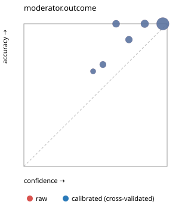

# Calibration: moderator.outcome

Model `qwen3.8-27b`, prompt `76e9344633ab`, 101 labelled cases, fitted temperature **T = 1.0** (2026-11-23).

| | accuracy | ECE | Brier |
|---|---|---|---|
| raw (T = 1) | 0.960 | 0.105 | 0.070 |
| calibrated, 5-fold cross-validated | 0.960 | 0.105 | 0.070 |

Risk-coverage (calibrated): the share of cases at or above each threshold and their accuracy.

| threshold | coverage | accuracy | n |
|---|---|---|---|
| 0.5 | 0.97 | 0.969 | 98 |
| 0.6 | 0.90 | 0.989 | 91 |
| 0.7 | 0.80 | 0.988 | 81 |
| 0.8 | 0.71 | 1.000 | 72 |
| 0.85 | 0.63 | 1.000 | 64 |
| 0.9 | 0.57 | 1.000 | 58 |
| 0.95 | 0.43 | 1.000 | 43 |
| 0.99 | 0.24 | 1.000 | 24 |

